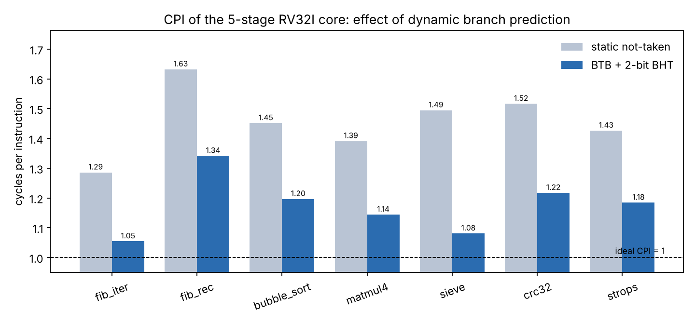
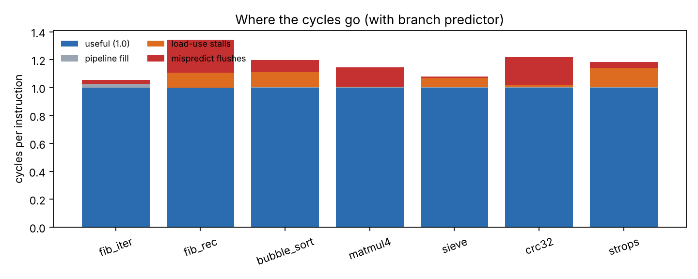
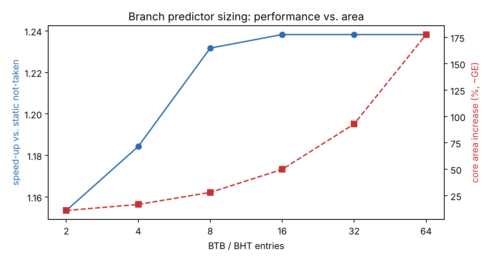

# 5-Stage Pipelined RISC-V (RV32I) Processor — RTL design, verification & analysis

A complete, **software-only** implementation of a classic 5-stage pipelined RISC-V CPU in synthesizable Verilog,
verified against an independent golden model, stress-tested with constrained-random programs, mutation-tested,
synthesized with Yosys, and analysed for performance and area. No FPGA or board needed: everything runs with
free tools (Icarus Verilog, Yosys, Python 3).

```
 IF ──► ID ──► EX ──► MEM ──► WB
 PC     decode  ALU    load/    reg
 BTB    regfile branch store    write
 BHT    imm-gen resolve
```

## Highlights

| | |
|---|---|
| ISA | Full RV32I base (all 37 user instructions; ECALL/EBREAK halt the simulation) |
| Pipeline | IF / ID / EX / MEM / WB, one instruction per cycle when no hazards |
| Data hazards | Full forwarding (EX/MEM→EX, MEM/WB→EX), write-through regfile, 1-cycle load-use stall |
| Control hazards | **Dynamic branch prediction in IF** (BTB + 2-bit BHT), resolution in EX, 2-cycle mispredict penalty |
| Verification | 4 unit TBs, 12 directed/self-checking programs, **400 random programs** vs. golden ISS, **35/35 injected bugs caught** |
| Analysis | CPI breakdown, predictor on/off, predictor-size sweep, Yosys area & logic depth |
| Tooling written from scratch | RV32I assembler, instruction-set simulator, random program generator, pipeline visualizer |

## Quick start

```bash
sudo apt install iverilog yosys python3 python3-matplotlib   # (gtkwave optional)
make test            # unit tests + directed + 200 random programs
make bench           # CPI table, plots -> results/, docs/
make synth           # Yosys synthesis report
make mutation        # bug-injection campaign (~3 min)
make trace P=hazard_demo     # cycle-by-cycle pipeline diagram
make wave  P=fib_iter        # VCD for GTKWave
```

## Microarchitecture

* **IF** – PC register; the branch predictor is looked up with the PC *before decode*. A BTB hit with a
  "taken" counter redirects fetch in the same cycle → a correctly predicted taken branch costs **0 bubbles**.
* **ID** – control decode, immediate generation, register read. The register file is *write-through*, so a
  value being written in WB is visible to a reader in ID the same cycle. The hazard unit detects load-use here.
* **EX** – forwarding muxes, ALU, branch comparator. Branches/JAL/JALR are resolved here; on a wrong
  direction or wrong target the front end (IF + ID) is flushed and fetch restarts at the correct PC (**2-cycle penalty**).
  The predictor is trained from this stage.
* **MEM** – byte-strobed stores (SB/SH/SW), load alignment and sign/zero extension (LB/LBU/LH/LHU/LW).
* **WB** – register write. `ECALL` squashes younger instructions and raises `halted` precisely when it reaches WB.

| Hazard | Mechanism | Cost |
|---|---|---|
| ALU → ALU (1 apart) | forward EX/MEM → EX | 0 |
| ALU/load → ALU (2 apart) | forward MEM/WB → EX | 0 |
| 3 apart | write-through register file | 0 |
| load → use (1 apart) | stall 1 cycle, then forward | 1 cycle |
| taken branch, predicted correctly | BTB redirect in IF | 0 |
| mispredicted branch / JALR | flush IF + ID | 2 cycles |

The cycle count obeys an exact accounting identity, **checked by the report script on every benchmark**:
`cycles = instructions + 4 (pipeline fill) + load-use stalls + 2 × mispredict flushes`.

The core (`cpu_core.v`) has plain memory ports (async read, byte-strobe write), so it is independent of
memory technology; `cpu_top.v` + `memories.v` wrap it for simulation only.

## Repository layout

```
rtl/         cpu_core, alu, regfile, imm_gen, control_unit, forwarding_unit, hazard_unit,
             branch_predictor (synthesizable)  +  memories, cpu_top (simulation only)
tb/          tb_cpu (top-level, dumps regs/mem/stats/trace), tb_alu, tb_regfile, tb_branch_predictor
tools/       rvasm.py (assembler) · rviss.py (golden ISS) · gen_random.py · gen_isa_tests.py · pipeview.py
tests/asm/   benchmarks + hazard demo (assembly) ·  tests/generated/  self-checking ISA tests
scripts/     regress.py · report.py · sweep_btb.py · mutation_test.py · synth_report.py
synth/       Yosys script       results/  generated tables       docs/  plots, pipeline trace
```

## Verification strategy

1. **Unit testbenches** – ALU (2.2 M vectors vs. a bit-serial reference model), register file (x0, bypass),
   branch predictor (learning, hysteresis, aliasing, disable).
2. **Golden reference** – `tools/rviss.py`, an instruction-set simulator written independently of the RTL.
   After every program the regression compares **all 32 registers, the full 16 KiB data memory and the retired
   instruction count** between RTL and ISS, for predictor on *and* off.
3. **Self-checking programs** – answers computed independently in Python (e.g. CRC-32 vs. `zlib`, prime count,
   matrix checksum) and asserted via `# CHECK xN value` headers; generated ISA tests cover every ALU op on
   corner values, all load/store widths and byte offsets, all six branches taken/not-taken, JAL/JALR link values.
4. **Constrained-random programs** – `gen_random.py` builds always-terminating programs with dependency chains,
   load-use pairs, nested loops, forward branches/jumps, calls/returns and sub-word memory traffic.
   **400/400 programs match the ISS.**
5. **Mutation testing** – 35 bugs injected one at a time (removed forwarding paths, swapped forward priority,
   missing load-use stall, wrong branch condition, wrong immediate encoding, missing sign extension, wrong store lane,
   no squash after ECALL, …). **All 35 were detected** (`results/mutation.log`); one (JALR bit-0 clearing)
   was only caught by the random suite — a nice demonstration of why random testing complements directed tests.

## Results

### Performance (7 benchmarks, 24 563 instructions)



| Benchmark | Instr. | CPI (no BP) | CPI (BTB+BHT) | Speed-up | Load-use stalls | Cond-branch accuracy |
|---|---:|---:|---:|---:|---:|---:|
| fib_iter | 147 | 1.286 | 1.054 | 1.22x | 0 | 90.0% |
| fib_rec | 11578 | 1.632 | 1.341 | 1.22x | 1218 | 50.2% |
| bubble_sort | 2887 | 1.451 | 1.196 | 1.21x | 317 | 81.3% |
| matmul4 | 2679 | 1.391 | 1.144 | 1.22x | 16 | 65.1% |
| sieve | 3184 | 1.495 | 1.081 | 1.38x | 211 | 97.1% |
| crc32 | 3187 | 1.516 | 1.217 | 1.25x | 64 | 71.3% |
| strops | 901 | 1.426 | 1.184 | 1.20x | 120 | 89.6% |
| **total** | 24563 | **1.542** | **1.245** | **1.24x** | | |

The dynamic predictor removes ~24 % of all cycles. Remaining loss: load-use stalls, data-dependent branches
(CRC, bubble sort) and `ret` instructions whose target changes per call site (`fib_rec`) — a return-address stack would be
the natural next step.



### Design-space exploration: how big should the predictor be?



| BTB/BHT entries | Total cycles | Speed-up | Flip-flops | Area vs. none |
|---:|---:|---:|---:|---:|
| none | 37879 | 1.000x | 1731 | +0% |
| 2 | 32839 | 1.153x | 1918 | +11% |
| 4 | 31983 | 1.184x | 2039 | +17% |
| **8** | 30753 | 1.232x | 2276 | **+28%** |
| 16 | 30591 | 1.238x | 2741 | +50% |
| 32 (default) | 30591 | 1.238x | 3654 | +93% |
| 64 | 30591 | 1.238x | 5447 | +178% |

On these small programs the gain saturates at 16 entries; **8 entries deliver 99.5 % of the benefit for 28 % area**.
(The default is 32 to be robust for larger programs; change `BP_INDEX_BITS`.) Caveat: the benchmark footprint is small,
so larger real workloads would favour bigger tables.

### Synthesis (Yosys, generic gates)

| Configuration | Cells | Flip-flops | ~Gate-equivalents | Logic depth |
|---|---:|---:|---:|---:|
| With 32-entry predictor | 13 565 | 3 654 | 44 438 | 89 levels |
| Without predictor | 7 123 | 1 731 | 23 030 | 78 levels |

Gate-equivalent weights are a rough rule of thumb; use them for *relative* comparison only. The critical path is
forwarding → ALU adder → branch compare → mispredict → PC mux, a typical limit of this pipeline organisation.
Full numbers: `results/synth.md`.

### Pipeline in action (`make trace P=hazard_demo`)

`docs/pipeline_trace.txt` shows every cycle; excerpt — a load immediately followed by its consumer (cycles 9–12),
then a loop branch learned by the predictor:

```
cyc  IF            | ID            | EX            | MEM           | WB            | events
  9  add t5,t4,t4 | lw t4,0(s0)   | sw t2,0(s0)   | addi s0,s0,64 | la s0,buf     | fwd rs1<-EX/MEM
 10  li t6,3       | add t5,t4,t4  | lw t4,0(s0)   | sw t2,0(s0)   | addi s0,s0,64 | LOAD-USE STALL (hold IF/ID, bubble->EX)
 11  li t6,3       | add t5,t4,t4  | -             | lw t4,0(s0)   | sw t2,0(s0)   |
 12  loop: addi ...| li t6,3       | add t5,t4,t4  | -             | lw t4,0(s0)   | fwd rs1<-MEM/WB, fwd rs2<-MEM/WB
```
(See the file for exact output.)

## Limitations & ideas for extension

* No M/C extensions, CSRs, interrupts or misaligned-access traps (documented simplifications).
* Memories are ideal (zero-latency); adding a cache controller or AXI-Lite wrapper is a natural next project.
* Add a return-address stack, a RV32M multiplier/divider, or a compliance run with `riscv-arch-test`.
* Try a larger/standard-cell flow (OpenLane/OpenROAD) to obtain real timing and area.

## License

MIT
